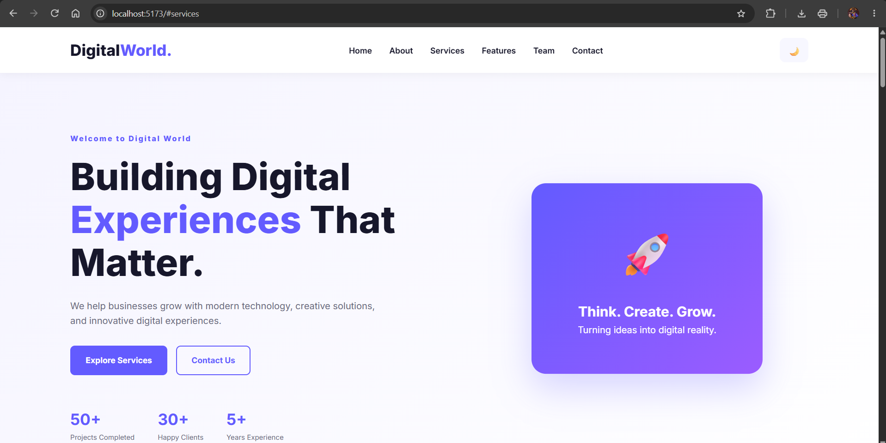
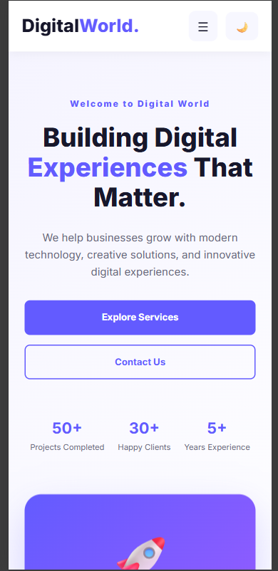

# Digital World – React Portfolio Website

## Project Overview

Digital World is a modern and responsive company portfolio website built using React.js. It showcases company information, services, features, team members, FAQs, and a contact section.

## Technologies Used

- React.js
- JavaScript (JSX)
- HTML5
- CSS3
- Vite

## Features

- Responsive Navigation Bar
- Mobile Navigation Toggle
- Dark Mode and Light Mode
- Animated Hero Section
- Dynamic Statistics Counter
- About Us Section
- Services Section with Details Toggle
- Features Section
- Team Section with Modal
- FAQ Accordion
- Contact Form with Controlled Inputs
- Scroll-to-Top Button
- Responsive Layout for Different Screen Sizes

## Structure

#Day-08-React-Fundamentals/
├── public/
├── src/
│   ├── assets/
│   ├── components/
│   │   ├── About.jsx
│   │   ├── Contact.jsx
│   │   ├── FAQ.jsx
│   │   ├── Features.jsx
│   │   ├── Footer.jsx
│   │   ├── Hero.jsx
│   │   ├── Navbar.jsx
│   │   ├── ScrollToTop.jsx
│   │   ├── Services.jsx
│   │   ├── StatsCounter.jsx
│   │   └── Team.jsx
│   ├── styles/
│   │   └── style.css
│   ├── App.css
│   ├── App.jsx
│   ├── index.css
│   └── main.jsx
├── index.html
├── package.json
└── README.md

## Installation and Setup

1. Clone or download the repository.
2. Open the project folder in VS Code.
3. Install dependencies:

```bash
npm install
```

4. Start the development server:

```bash
npm run dev
```

5. Open the local URL shown in the terminal.

## Screenshots

### Desktop View


### Mobile View

## Author

Developed as part of the Apex Lark Full Stack Development Internship Program.

